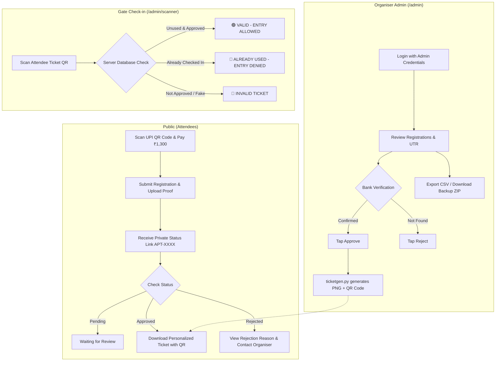

# 🎟️ Afterparty 2026–27 — Ticket Management & Verification System

[](https://www.python.org/downloads/)
[](https://flask.palletsprojects.com/)
[](https://www.sqlite.org/)
[](LICENSE)
[]()

A robust, self-hosted web platform designed for event ticketing, UPI payment reconciliation, dynamic ticket generation, and high-speed gate access control. Built with **Python Flask**, **Pillow**, **SQLite (WAL mode)**, and **HTML5 QR Code**.

---

## 📅 Event Overview

* **Event**: Afterparty 2026–27
* **Date**: 4 December 2026
* **Time**: 2:00 PM – 10:00 PM IST
* **Venue**: Sundaram, Tikoniya
* **Ticket Price**: ₹1,300
* **Organiser Contact**: +91 9627723371

---

## 🌟 Key Features

### 1. Attendee Registration & Payment Proof Submission
* **UPI Payment via QR**: Displays official payment QR code (PhonePe/Google Pay/Paytm).
* **Payment Proof Upload**: Accepts JPEG, PNG, or WebP screenshots (up to 8 MB). Screenshots are re-encoded on the server to strip EXIF data and neutralize malicious payloads.
* **UTR Tracking & Duplicate Detection**: Real-time checking flags duplicate 12-digit UTR/transaction numbers to prevent double-spending.
* **Private Ticket Status**: Each registrant receives a secret private link (`/status/<token>`) and unique reference ID (`APT-XXXXXXXX`).
* **Self-Service Ticket Recovery**: Attendees who lose their link can recover their ticket using **Reference Code + Mobile Number** via `/find`.

### 2. Organizer Dashboard (`/admin`)
* **Manual Verification Workflow**: Organizers inspect the registrant's name, phone, UTR, and high-resolution payment proof thumbnail before manually approving or rejecting.
* **One-Click Actions**:
  * **Approve**: Instantly synthesizes a high-res personalized ticket with a cryptographically secure QR code.
  * **Reject**: Prompts for an optional reason shown to the attendee (e.g., "UTR amount mismatch").
  * **Cancel / Reopen**: Revokes tickets or reopens registrations at any time.
* **Real-Time Search & Filters**: Search by full name, phone number, UTR, or ticket reference.
* **Data Portability & Disaster Recovery**:
  * **Export CSV**: Instant spreadsheet download with all registration data.
  * **Backup ZIP**: Complete snapshot containing SQLite database, uploaded proofs, and generated ticket PNGs.

### 3. Dynamic High-Fidelity Ticket Synthesis (`ticketgen.py`)
* **Original Artwork Preservation**: Preserves original 300 DPI ticket graphic (`static/ticket-original.jpg`).
* **Pixel Font Engine (`pixelfont.py`)**: Renders attendee's full name directly onto the original artwork using a custom hard-pixel font with drop shadows for maximum sharpness.
* **Adaptive Name Fitting**: Automatically scales font size and contracts middle names for long names without clipping.
* **192-Bit Cryptographic QR Token**: Embedded QR code carries a high-entropy random token. Only the SHA-256 hash (`ticket_token_hash`) is stored in the database, preventing ticket counterfeiting.

### 4. High-Speed Gate Scanner (`/admin/scanner`)
* **Mobile Camera Scanning**: Instant in-browser scanning using `html5-qrcode` (compatible with iOS Safari and Android Chrome).
* **Instant Visual & Audio Indicators**:
  * 🟢 **VALID — ENTRY ALLOWED**: Displays attendee name, ticket reference, and records entry timestamp.
  * 🔴 **ALREADY USED — ENTRY DENIED**: Displays attendee name and original admission time.
  * 🔴 **NOT APPROVED / INVALID TICKET**: Prevents unauthorized admission.
* **Zero Race Conditions**: Atomic SQLite transaction (`UPDATE registrations SET checked_in=1 WHERE ... AND checked_in=0`) tested and verified against 25 simultaneous concurrent scans.
* **Manual Gate Fallback**: Staff can enter ticket reference numbers (`APT-XXXXXXXX`) manually if camera scanning is hindered by scratched screens or low lighting.

### 5. Production Security & Hardening
* **Password Hashing**: Admin passwords hashed using secure PBKDF2:SHA-256 / Argon2.
* **CSRF Protection**: Token validation on all state-mutating requests.
* **Rate Limiting**: Throttles registration submissions, login attempts, and ticket status lookups.
* **Session Hardening**: `HttpOnly`, `SameSite=Lax`, and configurable `COOKIE_SECURE=1` for HTTPS.
* **Reverse Proxy Support**: Pre-configured `ProxyFix` middleware enabled via `TRUST_PROXY=1`.

---

## 🏗️ System Architecture



---

## 📁 Repository Structure

```text
├── app.py                     # Main Flask application and API routes
├── wsgi.py                    # WSGI entry point for Gunicorn / PythonAnywhere
├── ticketgen.py               # Personalized ticket and QR synthesis engine
├── pixelfont.py               # Custom pixel-art typography and font renderer
├── setup_local.py             # Interactive local admin configuration script
├── requirements.txt           # Python dependencies
├── Procfile                   # Process configuration for Render / Railway / Heroku
├── .env.example               # Template for environment configuration
├── .gitignore                 # Excludes secrets, databases, venv, and large media
├── START_HERE.bat             # 1-click Windows setup & launcher
├── START_TEST_MODE.bat        # Windows test mode with sample registrations
├── RUN_TESTS.bat              # Test suite runner
├── static/
│   ├── phonepe-qr.jpg         # Official UPI payment QR code
│   ├── ticket-original.jpg    # Master ticket artwork
│   ├── css/                   # Stylesheets
│   └── vendor/                # Standalone vendor libraries
├── templates/
│   ├── base.html              # Core HTML layout
│   ├── index.html             # Attendee registration page
│   ├── status.html            # Private ticket status & download page
│   ├── admin.html             # Organiser management dashboard
│   ├── scanner.html           # Camera QR scanner for gate admission
│   ├── login.html             # Admin authentication page
│   └── message.html           # System notification template
└── tests/
    └── test_app.py            # Automated unit and integration test suite
```

---

## ⚙️ Environment Configuration (`.env`)

Copy `.env.example` to `.env` and configure your settings:

```bash
cp .env.example .env
```

| Key | Default | Description |
|---|---|---|
| `ADMIN_USERNAME` | `organiser` | Username for dashboard & scanner login |
| `ADMIN_PASSWORD` | *required* | Strong password (at least 10 characters) |
| `SECRET_KEY` | *auto-generated* | Flask session signing secret key |
| `COOKIE_SECURE` | `0` | Set to `1` when running on public `https://` |
| `PAYEE_NAME` | `DEVANSH TOMAR` | Name displayed to attendees for UPI payment verification |
| `REGISTRATION_OPEN` | `1` | Set to `0` to close registrations when sold out |
| `TRUST_PROXY` | `0` | Set to `1` when behind a reverse proxy (Render, Railway, Nginx) |
| `DATABASE_PATH` | `data/afterparty.sqlite3` | Path to persistent SQLite database |
| `UPLOAD_DIR` | `data/payment-proofs` | Path to persistent directory for uploaded screenshots |
| `TICKET_DIR` | `data/tickets` | Path to persistent directory for generated tickets |

> [!CAUTION]
> **Never commit your `.env` file or `data/` directory to GitHub!** Your `.gitignore` is already pre-configured to keep credentials and user data private.

---

## 💻 Local Development Setup

### Windows (Quick Start)
1. Install [Python 3.10+](https://www.python.org/downloads/) (ensure **"Add Python to PATH"** is checked).
2. Double-click `START_HERE.bat`.
3. Enter your desired admin username and password.
4. Your browser will automatically open `http://127.0.0.1:5000`.

### Linux / macOS / Manual Windows Setup
```bash
# 1. Clone your repository
git clone https://github.com/<your-username>/afterparty.git
cd afterparty

# 2. Create and activate a virtual environment
python3 -m venv .venv
# Linux / macOS:
source .venv/bin/activate
# Windows:
.venv\Scripts\activate

# 3. Install dependencies
pip install --upgrade pip
pip install -r requirements.txt

# 4. Create environment file
cp .env.example .env
# Edit .env with your admin credentials

# 5. Run the application
python app.py
```

* **Attendee Portal**: [http://127.0.0.1:5000](http://127.0.0.1:5000)
* **Organiser Admin Dashboard**: [http://127.0.0.1:5000/admin](http://127.0.0.1:5000/admin)
* **Gate QR Scanner**: [http://127.0.0.1:5000/admin/scanner](http://127.0.0.1:5000/admin/scanner)

---

## 🚀 How to Push to GitHub

### Step 1: Create a Repository on GitHub
1. Log in to [GitHub](https://github.com/).
2. Click **New** (or visit [github.com/new](https://github.com/new)).
3. Repository name: `afterparty` (or your preferred name).
4. Set repository visibility to **Public** or **Private**.
5. **Do NOT** initialize with a README, .gitignore, or license (we already have them).
6. Click **Create repository**.

### Step 2: Initialize, Commit, and Push
Run the following commands in your project terminal:

```bash
# Ensure you are on the main branch
git branch -M main

# Add all project files
git add .

# Create initial commit
git commit -m "feat: initial commit for Afterparty ticket management system"

# Link to your remote GitHub repository (replace with your actual GitHub URL)
git remote add origin https://github.com/<YOUR-GITHUB-USERNAME>/afterparty.git

# Push to GitHub
git push -u origin main
```

---

## 🌐 Production Deployment Guide

> [!IMPORTANT]
> **Data Persistence Notice**: SQLite databases and attendee uploads live in the `data/` directory. Choose a hosting option that provides **persistent disk storage** so registrations and tickets are never lost when the server restarts.

---

### Option A: Render (Recommended Cloud Deployment)

1. Create a free account at [render.com](https://render.com/).
2. Click **New +** → **Web Service**.
3. Connect your GitHub repository (`afterparty`).
4. Configure the service:
   * **Name**: `afterparty-tickets`
   * **Region**: Choose the closest region (e.g., Singapore or Frankfurt).
   * **Branch**: `main`
   * **Runtime**: `Python 3`
   * **Build Command**: `pip install -r requirements.txt`
   * **Start Command**: `gunicorn wsgi:app`
5. Under **Advanced** → **Environment Variables**, add:
   * `ADMIN_USERNAME` = `your-admin-username`
   * `ADMIN_PASSWORD` = `your-strong-password`
   * `COOKIE_SECURE` = `1`
   * `TRUST_PROXY` = `1`
   * `PAYEE_NAME` = `DEVANSH TOMAR`
   * `REGISTRATION_OPEN` = `1`
6. *(For Paid Render Plans)* Add a **Persistent Disk**:
   * Mount Path: `/opt/render/project/src/data`
   * Size: 1 GB+
7. Click **Create Web Service**. Your HTTPS site is live!

---

### Option B: PythonAnywhere (Beginner Friendly, Native Persistent Disk)

PythonAnywhere provides persistent storage by default and is well-suited for Python WSGI applications.

1. Create an account at [pythonanywhere.com](https://www.pythonanywhere.com/).
2. Open **Consoles** → **Bash** and clone your repo:
   ```bash
   git clone https://github.com/<YOUR-GITHUB-USERNAME>/afterparty.git
   cd afterparty
   ```
3. Set up the virtual environment:
   ```bash
   mkvirtualenv --python=python3.12 afterparty-env
   pip install -r requirements.txt
   cp .env.example .env
   nano .env  # set ADMIN_PASSWORD and COOKIE_SECURE=1
   ```
4. Navigate to the **Web** tab:
   * Click **Add a new web app** → **Manual configuration** → **Python 3.12**.
   * **Source code**: `/home/<YOURNAME>/afterparty`
   * **Working directory**: `/home/<YOURNAME>/afterparty`
   * **Virtualenv**: `/home/<YOURNAME>/.virtualenvs/afterparty-env`
   * **Static files**:
     * URL: `/static/`
     * Directory: `/home/<YOURNAME>/afterparty/static`
   * **WSGI configuration file**: Click the link, delete all code, and paste:
     ```python
     import sys
     path = '/home/<YOURNAME>/afterparty'
     if path not in sys.path:
         sys.path.insert(0, path)
     from wsgi import application
     ```
   * Enable **Force HTTPS**.
   * Click **Reload <yourname>.pythonanywhere.com**.

---

### Option C: Railway

1. Sign in to [railway.app](https://railway.app/).
2. Click **New Project** → **Deploy from GitHub repo**.
3. Select `afterparty`.
4. In **Variables**, add:
   * `ADMIN_USERNAME` = `organiser`
   * `ADMIN_PASSWORD` = `your-secure-password`
   * `COOKIE_SECURE` = `1`
   * `TRUST_PROXY` = `1`
   * `PAYEE_NAME` = `DEVANSH TOMAR`
5. In **Volumes**, attach a persistent volume mounted to `/app/data`.
6. Railway automatically detects `requirements.txt` and `Procfile` to deploy.

---

### Option D: Ubuntu / Debian VPS (Self-Hosted with Nginx & Systemd)

```bash
# Install system packages
sudo apt update && sudo apt install -y python3-venv python3-pip nginx certbot python3-certbot-nginx

# Clone and setup
git clone https://github.com/<YOUR-GITHUB-USERNAME>/afterparty.git /var/www/afterparty
cd /var/www/afterparty
python3 -m venv .venv
source .venv/bin/activate
pip install -r requirements.txt
cp .env.example .env

# Create Systemd service (/etc/systemd/system/afterparty.service)
sudo tee /etc/systemd/system/afterparty.service > /dev/null <<EOF
[Unit]
Description=Afterparty Ticket Service
After=network.target

[Service]
User=www-data
WorkingDirectory=/var/www/afterparty
ExecStart=/var/www/afterparty/.venv/bin/gunicorn --workers 3 --bind 127.0.0.1:5000 wsgi:app
Restart=always

[Install]
WantedBy=multi-user.target
EOF

# Start and enable service
sudo chown -R www-data:www-data /var/www/afterparty
sudo systemctl daemon-reload
sudo systemctl enable --now afterparty

# Configure SSL certificate with Certbot
sudo certbot --nginx -d your-domain.com
```

---

## 🛡️ Gate Operations Field Guide (Event Night)

On the evening of the event, gate security and admission staff should follow these steps:

1. **Access the Scanner**: Open `https://your-domain.com/admin/scanner` on any smartphone.
2. **Log In**: Sign in using your organizer credentials.
3. **Camera Permission**: Tap **Start camera** and allow browser camera permissions.
4. **Scan Passes**:
   * Point the camera at attendee ticket QR codes (printed or on phone screens).
   * **🟢 GREEN ("VALID — ENTRY ALLOWED")**: Admit attendee. The ticket is immediately invalidated for subsequent entries.
   * **🔴 RED ("ALREADY USED — ENTRY DENIED")**: Deny entry. Staff will see the attendee name and the exact time the ticket was first scanned.
   * **🔴 RED ("NOT APPROVED" / "INVALID TICKET")**: Deny entry. Direct attendee to help desk.
5. **Manual Entry Fallback**: If a phone screen is cracked or camera cannot read the QR, type the ticket reference code (`APT-XXXXXXXX`) in the search box, click **Look up**, and click **Admit & mark as used**.

---

## 💾 Backup & Data Restoration

All vital state is stored inside the `data/` directory:
* `data/afterparty.sqlite3`: Registrations, check-in timestamps, audit logs, and rate limit counters.
* `data/payment-proofs/`: Uploaded UPI screenshots.
* `data/tickets/`: Rendered attendee tickets and QR code images.

### To Create a Backup:
* From Dashboard: Click the **Backup** button at `/admin` to instantly download a consolidated ZIP archive.
* From Command Line:
  ```bash
  zip -r backup_$(date +%Y%m%d).zip data/ .env
  ```

### To Restore a Backup:
1. Stop the web service.
2. Unzip the backup contents into the `data/` directory.
3. Restart the service.

---

## 🧪 Testing

The repository includes comprehensive automated tests covering registration, token generation, duplicate detection, race condition mitigation, and image processing.

To run tests:
```bash
# Windows
RUN_TESTS.bat

# Linux / macOS
python -m pip install opencv-python-headless numpy
python -m unittest discover -s tests -v
```

---

## 📄 License

This project is licensed under the MIT License — see the [LICENSE](LICENSE) file for details.

